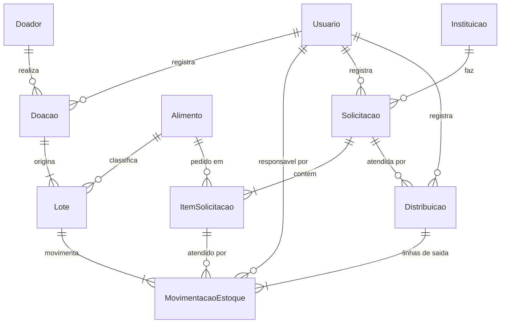

# Modelagem de Dados — Conecta Alimento

> **Status: versão consolidada para aprovação final do responsável pelo produto (Tarefa 2).**
> Esta versão incorpora a revisão do modelo de dados, incluindo estorno integral de distribuição,
> limiar de vencimento de sete dias, categorias de estoque, identificação interna e de origem dos lotes,
> compatibilidade do SQLite e referência temporal local centralizada na aplicação Python.
> **Nada aqui está implementado no projeto:** o banco SQLite, os módulos Python e os testes
> serão criados em tarefas posteriores, depois da aprovação do modelo.

## 1. Objetivo e escopo

Consolidar o modelo de dados do MVP a partir das dez entidades originalmente propostas (Doador, Alimento, Instituicao, Usuario, Doacao, Lote, Solicitacao, ItemSolicitacao, Distribuicao e MovimentacaoEstoque), resolvendo cinco pontos:

1. Distribuições parciais e distribuições com múltiplos lotes.
2. Unidades de medida (kg, litros e unidades).
3. Integridade do estoque.
4. Integridade relacional no SQLite.
5. Histórico e auditoria.

O documento cobre o modelo, as regras e a justificativa das decisões. Ele não contém código de produção, não define telas e não define permissões por perfil.

## 2. Resumo das decisões

| Id | Decisão | Seção |
|---|---|---|
| D1 | **Não criar `ItemDistribuicao`.** A linha "item × lote" de uma distribuição é uma `MovimentacaoEstoque` do tipo `SAIDA_DISTRIBUICAO`. O modelo continua com 10 entidades. | 4.1, 8 |
| D2 | Quantidades são **inteiros em unidade base** (g, mL, un). Cada alimento tem **uma única unidade**, imutável depois de usada. Não há conversões. | 4.2, 7 |
| D3 | `MovimentacaoEstoque` é **append-only**. A quantidade é sempre positiva e o `tipo` define o sentido (**6 tipos**: os cinco originais mais `ESTORNO_DISTRIBUICAO`, que reverte **integralmente** uma `SAIDA_DISTRIBUICAO` específica). | 5.2, 9 |
| D4 | O saldo **nunca é armazenado**. Ele é calculado a partir das movimentações. | 9 |
| D5 | A consistência entre lote, alimento, item e solicitação é garantida por **chaves estrangeiras compostas**, com `id_alimento` e `id_solicitacao` repetidos na movimentação. | 4.1, 6.1 |
| D6 | Validação amigável no serviço, dentro de transação `BEGIN IMMEDIATE`, mais **seis regras em triggers** como rede de segurança. A referência de data local é obtida centralmente em Python e passada explicitamente às consultas e validações. | 6.2, 6.3, 6.6 |
| D7 | **Sem exclusão física** de histórico (`ON DELETE RESTRICT`). Cadastros usam desativação lógica. | 10 |
| D8 | `Solicitacao.status` guarda só estados administrativos (`ABERTA`, `ENCERRADA`, `CANCELADA`). O grau de atendimento é **derivado**. | 5.2, 9 |
| D9 | `Doacao` e `Distribuicao` **não têm `status`**. O registro existe somente depois de confirmado, em transação atômica. | 5.2, 14 |
| D10 | Datas em `TEXT` ISO-8601 validadas por `CHECK`. Tabelas `STRICT`. | 3 |

Os pontos que dependem de aprovação do responsável pelo produto estão na seção 14.

## 3. Convenções

- **Chaves primárias:** `INTEGER PRIMARY KEY` em todas as tabelas. Sem `AUTOINCREMENT`, porque registros referenciados nunca são excluídos.
- **Tabelas `STRICT`** (SQLite 3.37 ou superior). Impedem gravar texto ou número fracionário em coluna `INTEGER`. Antes da implementação, verificar a versão embutida com `import sqlite3; print(sqlite3.sqlite_version)`. Se for inferior a 3.37, seguir o plano de contingência descrito na seção 6.5 (P7).
- **Datas de negócio:** `TEXT` no formato `AAAA-MM-DD`, validadas por `CHECK (date(coluna) IS coluna)`. Isso rejeita `2026-02-30` e `03/11/2026`.
- **Carimbo de movimentação:** `TEXT` no formato ISO-8601 com deslocamento explícito de fuso (`AAAA-MM-DDTHH:MM:SS±HH:MM`), preenchido pelo serviço Python a partir do provedor de relógio centralizado (seção 6.6). Não utilizar `DEFAULT CURRENT_TIMESTAMP` para simular horário local. A data de referência para regras de validade e alertas é derivada do mesmo instante local.
- **Booleanos:** `INTEGER` com `CHECK (ativo IN (0,1))`.
- **Quantidades:** inteiros em **unidade base** (seção 7).
- **Chaves estrangeiras:** todas com `ON DELETE RESTRICT`. A aplicação deve abrir **toda** conexão com `PRAGMA foreign_keys = ON` (seção 6.5).
- **Identificadores** sem acentos, como no contexto do projeto. Textos exibidos ao usuário ficam em português.

## 4. Alternativas avaliadas

### 4.1 Distribuições parciais e múltiplos lotes

O modelo precisa responder, para cada saída de estoque por distribuição: qual solicitação a originou, qual item solicitado foi atendido, quanto foi entregue, de qual lote saiu, quem registrou e quando.

| Alternativa | Descrição | Problema principal | Veredito |
|---|---|---|---|
| **A1. Modelo original** | `MovimentacaoEstoque` com `id_distribuicao` e `id_item_solicitacao` anuláveis, sem chaves compostas. | Nada impede um lote de feijão atender um item de arroz, nem um item de outra solicitação aparecer na distribuição. As colunas anuláveis dependem do `tipo`, sem verificação. | Insuficiente |
| **A2. `ItemDistribuicao` mais movimentação** | Nova tabela (distribuição, item, lote, quantidade) e movimentação que a referencia. | A quantidade existe em dois lugares (item da distribuição e movimentação). É preciso garantir que sejam iguais. Viola o princípio DRY e cria duas fontes de verdade. | Rejeitada |
| **A3. `ItemDistribuicao` como única fonte da saída** | A saída de distribuição vive só em `ItemDistribuicao`. O saldo une movimentações e itens. | Quebra a regra "saldo exclusivamente pelas movimentações". Toda consulta de saldo precisa de união. Risco de esquecer uma fonte. | Rejeitada |
| **A4. Linha na própria movimentação, com chaves compostas** (recomendada) | Cada linha de distribuição é uma `MovimentacaoEstoque` `SAIDA_DISTRIBUICAO` com (distribuição, item, lote, quantidade). Chaves compostas e `CHECK` por tipo garantem a coerência. | Exige repetir `id_alimento` e `id_solicitacao` na movimentação e quatro índices `UNIQUE` nas tabelas pai. | **Adotada (D1, D5)** |

**Por que A4 é a mais simples que preserva integridade e rastreabilidade:**

- A quantidade existe uma única vez, na movimentação. Não há duplicação a reconciliar.
- O número de entidades não aumenta.
- A coerência vira restrição declarativa do banco (FK composta, `CHECK`, `UNIQUE`), verificável com `PRAGMA foreign_key_check`, e não apenas disciplina do código Python.
- Todas as perguntas da tarefa têm resposta direta (seção 8).

**Quando `ItemDistribuicao` passaria a ser justificada:** se o produto passar a exigir distribuição em **rascunho** (planejada antes de confirmada) ou **reserva** de estoque. Nesses casos existiria quantidade planejada diferente da quantidade movimentada, e a tabela deixaria de ser duplicação. Isso está fora do MVP.

### 4.2 Unidades de medida

| Alternativa | Descrição | Problema | Veredito |
|---|---|---|---|
| **B1. `REAL` (ponto flutuante)** | Guardar 2,5 kg como `2.5`. | Erros binários de arredondamento (0,1 + 0,2 ≠ 0,3). Somas de saldo podem divergir. | Rejeitada |
| **B2. Decimal em `TEXT`** | Guardar `"2.500"` e usar `Decimal` no Python. | O SQLite não soma texto com exatidão. Os totais precisariam sair do banco para o Python. | Rejeitada |
| **B3. `INTEGER` em unidade base** (recomendada) | Guardar gramas, mililitros e unidades inteiras. 2,5 kg vira `2500`. | A interface converte na entrada e na exibição. | **Adotada (D2)** |
| **B4. Tabela `Unidade` com fatores de conversão** | Várias unidades por alimento e conversões entre elas. | Complexidade sem demanda no MVP. | Rejeitada (YAGNI) |

### 4.3 Integridade do estoque

| Tema | Alternativas | Decisão |
|---|---|---|
| **Onde fica o saldo** | (a) coluna `saldo` em `Lote`; (b) calculado a partir das movimentações. | (b). A coluna `saldo` seria uma segunda fonte de verdade e proibida pelo contexto. |
| **Representação do sentido** | (a) quantidade com sinal; (b) quantidade sempre positiva e `tipo` define o sentido. | (b). Evita erro de sinal, e cada tipo tem regras próprias (justificativa, vínculos). `CHECK (quantidade > 0)` fica simples. |
| **Impedir estoque negativo** | (a) só no serviço Python; (b) serviço **mais** trigger no banco. | (b). O serviço dá a mensagem amigável e controla a transação. O trigger impede que um erro de código ou um acesso direto ao banco quebre a regra inegociável. |

## 5. Modelo relacional consolidado

### 5.1 Diagrama



Cardinalidades como `||--|{` ("um para um ou mais") indicam obrigatoriedade que o banco **não** consegue impor sozinho em tabelas filhas. Elas são garantidas pelo serviço, em transação, e verificadas pelas consultas da seção 6.4.

### 5.2 Entidades e atributos

Legenda: **PK** chave primária, **FK** chave estrangeira, **NN** `NOT NULL`, **UQ** `UNIQUE`.

#### Doador

| Atributo | Tipo | Restrições |
|---|---|---|
| `id_doador` | INTEGER | PK |
| `nome` | TEXT | NN, não vazio |
| `tipo` | TEXT | NN, `CHECK IN ('PESSOA_FISICA','EMPRESA','ORGANIZACAO')` (valores provisórios, P2) |
| `telefone`, `email` | TEXT | opcionais |
| `ativo` | INTEGER | NN, padrão 1, `IN (0,1)` |

Por minimização de dados, o modelo não guarda CPF, CNPJ nem endereço do doador.

#### Alimento

| Atributo | Tipo | Restrições |
|---|---|---|
| `id_alimento` | INTEGER | PK |
| `nome` | TEXT | NN, não vazio, UQ sem diferenciar maiúsculas (`COLLATE NOCASE`) |
| `categoria` | TEXT | NN, não vazio |
| `unidade_medida` | TEXT | NN, `CHECK IN ('KG','L','UN')`. **Imutável depois do primeiro uso** (T5) |
| `ativo` | INTEGER | NN, padrão 1 |

#### Instituicao

| Atributo | Tipo | Restrições |
|---|---|---|
| `id_instituicao` | INTEGER | PK |
| `nome` | TEXT | NN, não vazio, UQ sem diferenciar maiúsculas |
| `tipo` | TEXT | NN, `CHECK IN ('COZINHA_SOLIDARIA','ASSOCIACAO','OUTRA')` (provisório, P2) |
| `responsavel` | TEXT | NN, não vazio |
| `telefone`, `email`, `endereco` | TEXT | opcionais |
| `ativo` | INTEGER | NN, padrão 1 |

#### Usuario

| Atributo | Tipo | Restrições |
|---|---|---|
| `id_usuario` | INTEGER | PK |
| `nome` | TEXT | NN, não vazio |
| `login` | TEXT | NN, UQ sem diferenciar maiúsculas, mínimo 3 caracteres |
| `senha_hash` | TEXT | NN, não vazio. Somente hash robusto, nunca senha em texto |
| `perfil` | TEXT | NN, `CHECK IN ('ADMINISTRADOR','ESTOQUE','OPERADOR')` (provisório, P2) |
| `ativo` | INTEGER | NN, padrão 1 |

#### Doacao

Uma `Doacao` só existe depois do **recebimento confirmado** (D9). Ela é criada na mesma transação que seus lotes e entradas de estoque.

| Atributo | Tipo | Restrições |
|---|---|---|
| `id_doacao` | INTEGER | PK |
| `id_doador` | INTEGER | FK → Doador, NN |
| `id_usuario` | INTEGER | FK → Usuario, NN (responsável pelo registro) |
| `data_recebimento` | TEXT | NN, data válida |
| `observacao` | TEXT | opcional |

#### Lote

| Atributo | Tipo | Restrições |
|---|---|---|
| `id_lote` | INTEGER | PK |
| `id_doacao` | INTEGER | FK → Doacao, NN |
| `id_alimento` | INTEGER | FK → Alimento, NN |
| `codigo_lote` | TEXT | NN, não vazio, **UQ global**, **gerado pelo sistema**. Identifica o lote de forma única dentro do Conecta Alimento, independentemente da origem. O formato é definido na implementação. |
| `codigo_origem` | TEXT | Opcional. Código de lote informado pelo doador ou fabricante (ex.: número de série da embalagem). Não é único: o mesmo código pode aparecer em doações de doadores diferentes sem causar conflito. |
| `data_validade` | TEXT | NN, data válida (P5) |
| `observacao` | TEXT | opcional |
| — | — | `UNIQUE (id_lote, id_alimento)`, alvo da FK composta |

O lote **não tem coluna de quantidade**. A quantidade recebida é a movimentação `ENTRADA_DOACAO` do lote (exatamente uma por lote).

#### Solicitacao

| Atributo | Tipo | Restrições |
|---|---|---|
| `id_solicitacao` | INTEGER | PK |
| `id_instituicao` | INTEGER | FK → Instituicao, NN |
| `id_usuario` | INTEGER | FK → Usuario, NN |
| `data_solicitacao` | TEXT | NN, data válida |
| `status` | TEXT | NN, padrão `'ABERTA'`, `CHECK IN ('ABERTA','ENCERRADA','CANCELADA')` |
| `observacao` | TEXT | opcional |

`ENCERRADA` é o fechamento manual de uma solicitação com atendimento parcial que não será mais completado. Sem esse estado, uma solicitação parcial ficaria pendente para sempre. Pendente, parcialmente atendida e atendida são **derivados** (seção 9).

#### ItemSolicitacao

| Atributo | Tipo | Restrições |
|---|---|---|
| `id_item_solicitacao` | INTEGER | PK |
| `id_solicitacao` | INTEGER | FK → Solicitacao, NN |
| `id_alimento` | INTEGER | FK → Alimento, NN |
| `quantidade_solicitada` | INTEGER | NN, `> 0`, em unidade base |
| — | — | `UNIQUE (id_solicitacao, id_alimento)`: um item por alimento em cada solicitação |
| — | — | `UNIQUE (id_item_solicitacao, id_solicitacao)` e `UNIQUE (id_item_solicitacao, id_alimento)`: alvos das FKs compostas |

#### Distribuicao

Cabeçalho da entrega. Existe somente depois de confirmada (D9).

| Atributo | Tipo | Restrições |
|---|---|---|
| `id_distribuicao` | INTEGER | PK |
| `id_solicitacao` | INTEGER | FK → Solicitacao, NN |
| `id_usuario` | INTEGER | FK → Usuario, NN |
| `data_distribuicao` | TEXT | NN, data válida; preenchida pelo serviço com a referência de data local, não editável pelo usuário no MVP |
| `observacao` | TEXT | opcional |
| — | — | `UNIQUE (id_distribuicao, id_solicitacao)`, alvo da FK composta |

#### MovimentacaoEstoque

Registro único de **todo** efeito sobre o estoque. É imutável.

| Atributo | Tipo | Restrições |
|---|---|---|
| `id_movimentacao` | INTEGER | PK |
| `id_lote` | INTEGER | NN |
| `id_alimento` | INTEGER | NN. Repetição controlada: a FK composta `(id_lote, id_alimento)` → `Lote` garante que coincide com o alimento do lote |
| `id_usuario` | INTEGER | FK → Usuario, NN (responsável) |
| `tipo` | TEXT | NN, um dos seis tipos da tabela abaixo |
| `quantidade` | INTEGER | NN, `> 0`, em unidade base |
| `data_movimentacao` | TEXT | NN, timestamp ISO-8601 com deslocamento de fuso, fornecido pelo serviço Python; não editável pela interface |
| `motivo` | TEXT | obrigatório e não vazio nos tipos `PERDA`, `AJUSTE_ENTRADA`, `AJUSTE_SAIDA` e `ESTORNO_DISTRIBUICAO` |
| `id_distribuicao` | INTEGER | só em `SAIDA_DISTRIBUICAO` e `ESTORNO_DISTRIBUICAO` |
| `id_item_solicitacao` | INTEGER | só em `SAIDA_DISTRIBUICAO` e `ESTORNO_DISTRIBUICAO` |
| `id_solicitacao` | INTEGER | só em `SAIDA_DISTRIBUICAO` e `ESTORNO_DISTRIBUICAO`. Repetição controlada pelas FKs compostas |
| `id_movimentacao_original` | INTEGER | FK → MovimentacaoEstoque(`id_movimentacao`). Obrigatório e não nulo apenas em `ESTORNO_DISTRIBUICAO`; nulo em todos os demais tipos. Referencia a `SAIDA_DISTRIBUICAO` que está sendo revertida. |

| Tipo | Sentido | Motivo | Vínculos |
|---|---|---|---|
| `ENTRADA_DOACAO` | entrada | opcional | lote (uma única por lote) |
| `AJUSTE_ENTRADA` | entrada | **obrigatório** | lote |
| `SAIDA_DISTRIBUICAO` | saída | opcional | lote, distribuição, item e solicitação |
| `PERDA` | saída | **obrigatório** | lote |
| `AJUSTE_SAIDA` | saída | **obrigatório** | lote |
| `ESTORNO_DISTRIBUICAO` | entrada | **obrigatório** | lote, distribuição (original), item (original), solicitação (original), `id_movimentacao_original` |

**Regras de vínculos por tipo (`CHECK`):**

- `SAIDA_DISTRIBUICAO` e `ESTORNO_DISTRIBUICAO` exigem `id_distribuicao`, `id_item_solicitacao` e `id_solicitacao` não nulos; os demais tipos exigem os três nulos.
- `ESTORNO_DISTRIBUICAO` exige `id_movimentacao_original IS NOT NULL`; os demais tipos exigem `id_movimentacao_original IS NULL`.
- `PERDA`, `AJUSTE_ENTRADA`, `AJUSTE_SAIDA` e `ESTORNO_DISTRIBUICAO` exigem `motivo` não vazio.

**Índices `UNIQUE` parciais adicionais em `MovimentacaoEstoque`:**

- Uma única `ENTRADA_DOACAO` por lote: `UNIQUE (id_lote)` onde `tipo = 'ENTRADA_DOACAO'`.
- Sem linha duplicada em uma distribuição: `UNIQUE (id_distribuicao, id_item_solicitacao, id_lote)` onde `tipo = 'SAIDA_DISTRIBUICAO'`.
- Um único estorno por movimentação de origem: `UNIQUE (id_movimentacao_original)` onde `tipo = 'ESTORNO_DISTRIBUICAO'`. Impede que a mesma `SAIDA_DISTRIBUICAO` seja estornada duas vezes.

### 5.3 Relacionamentos e cardinalidades

| Relacionamento | Cardinalidade | Observação |
|---|---|---|
| Doador → Doacao | 1 : N | |
| Doacao → Lote | 1 : N (mínimo 1) | Mínimo garantido pelo serviço |
| Alimento → Lote | 1 : N | |
| Lote → MovimentacaoEstoque | 1 : N (mínimo 1) | A primeira é sempre `ENTRADA_DOACAO` (T2) |
| Instituicao → Solicitacao | 1 : N | |
| Solicitacao → ItemSolicitacao | 1 : N (mínimo 1) | Um item por alimento |
| Solicitacao → Distribuicao | 1 : N | Várias entregas parciais |
| Distribuicao → MovimentacaoEstoque | 1 : N (mínimo 1) | Uma linha por (item × lote) em SAIDA_DISTRIBUICAO; estornos referenciam o id_distribuicao original |
| ItemSolicitacao → MovimentacaoEstoque | 1 : N | Várias linhas, de lotes e entregas diferentes; também referenciada por estornos |
| MovimentacaoEstoque → MovimentacaoEstoque | 0..1 : 0..1 | `id_movimentacao_original`: cada `SAIDA_DISTRIBUICAO` pode ter ao mais um `ESTORNO_DISTRIBUICAO` |
| Usuario → Doacao, Solicitacao, Distribuicao, MovimentacaoEstoque | 1 : N | Responsável pela operação |

## 6. Regras de integridade

### 6.1 Regras declarativas (impostas pelo próprio esquema)

| Regra | Mecanismo |
|---|---|
| Não existe saldo digitado | Não há coluna de saldo. Ele é calculado (seção 9) |
| Quantidade inteira e positiva | Coluna `INTEGER` em tabela `STRICT` mais `CHECK (quantidade > 0)` |
| Vínculos coerentes com o tipo | `CHECK`: `SAIDA_DISTRIBUICAO` e `ESTORNO_DISTRIBUICAO` exigem distribuição, item e solicitação. Os demais tipos exigem os três vazios |
| Estorno referencia movimentação de origem | `CHECK (tipo != 'ESTORNO_DISTRIBUICAO' OR id_movimentacao_original IS NOT NULL)` e `CHECK (tipo = 'ESTORNO_DISTRIBUICAO' OR id_movimentacao_original IS NULL)` |
| Perda, ajuste e estorno com justificativa e responsável | `CHECK` sobre `motivo` e `id_usuario NOT NULL` |
| O lote pertence ao alimento informado | FK composta `(id_lote, id_alimento)` → `Lote` |
| O item atendido é do mesmo alimento do lote | FK composta `(id_item_solicitacao, id_alimento)` → `ItemSolicitacao` |
| O item pertence à solicitação da distribuição | FKs compostas `(id_distribuicao, id_solicitacao)` → `Distribuicao` e `(id_item_solicitacao, id_solicitacao)` → `ItemSolicitacao` |
| Uma entrada de doação por lote | Índice `UNIQUE` parcial em `(id_lote)` onde `tipo = 'ENTRADA_DOACAO'` |
| Sem linha duplicada em uma distribuição | Índice `UNIQUE` parcial em `(id_distribuicao, id_item_solicitacao, id_lote)` onde `tipo = 'SAIDA_DISTRIBUICAO'` |
| Um único estorno por movimentação de origem | Índice `UNIQUE` parcial em `(id_movimentacao_original)` onde `tipo = 'ESTORNO_DISTRIBUICAO'` |
| Um item por alimento em cada solicitação | `UNIQUE (id_solicitacao, id_alimento)` |
| Nomes e logins únicos | `UNIQUE` com `COLLATE NOCASE` |
| Datas válidas | `CHECK (date(coluna) IS coluna)` |
| Sem exclusão de histórico referenciado | `ON DELETE RESTRICT` em todas as FKs |

As FKs compostas seguem a semântica `MATCH SIMPLE` do SQLite: se qualquer coluna da chave for nula, a FK não é verificada. Por isso as linhas que não são `SAIDA_DISTRIBUICAO` nem `ESTORNO_DISTRIBUICAO` (com os três vínculos nulos) não são afetadas, e o `CHECK` por tipo garante que essas movimentações nunca tenham vínculo nulo.

### 6.2 Triggers (rede de segurança)

Regras que dependem de agregação não cabem em `CHECK` nem em FK. Seis regras, em sete triggers:

| Id | Regra | Evento |
|---|---|---|
| T1 | Movimentação é imutável: `UPDATE` e `DELETE` são abortados. Correção é feita com nova movimentação justificada | `BEFORE UPDATE` e `BEFORE DELETE` em `MovimentacaoEstoque` |
| T2 | O lote precisa ter `ENTRADA_DOACAO` antes de qualquer outra movimentação | `BEFORE INSERT` em `MovimentacaoEstoque` |
| T3 | **Sem saldo negativo:** uma saída (`SAIDA_DISTRIBUICAO`, `PERDA` ou `AJUSTE_SAIDA`) não pode exceder o saldo atual do lote. **`SAIDA_DISTRIBUICAO` é rejeitada quando `Lote.data_validade` for anterior a `Distribuicao.data_distribuicao`**. Essa data é gravada pelo serviço com a referência local obtida em Python. `PERDA` e `AJUSTE_SAIDA` em lote vencido permanecem permitidos, pois são necessários para zerar o saldo físico. O trigger não consulta `date('now')`. | `BEFORE INSERT` em `MovimentacaoEstoque` |
| T4 | `SAIDA_DISTRIBUICAO` só em solicitação `ABERTA` e **nunca acima do pendente** do item. Pendente = `quantidade_solicitada − (Σ SAIDA_DISTRIBUICAO − Σ ESTORNO_DISTRIBUICAO)` para o mesmo `id_item_solicitacao`. | `BEFORE INSERT` em `MovimentacaoEstoque` |
| T5 | `Alimento.unidade_medida` não muda depois que o alimento tem lote ou item solicitado | `BEFORE UPDATE OF unidade_medida` em `Alimento` |
| T6 | **Validação do estorno integral:** ao inserir `ESTORNO_DISTRIBUICAO`, verifica que: (a) `id_movimentacao_original` referencia uma movimentação existente do tipo `SAIDA_DISTRIBUICAO`; (b) `id_lote`, `id_alimento`, `id_distribuicao`, `id_item_solicitacao` e `id_solicitacao` coincidem com os da original; (c) a quantidade do estorno é **exatamente igual** à quantidade da movimentação original; (d) não existe outro estorno para a mesma origem (também protegido pelo índice `UNIQUE` parcial). | `BEFORE INSERT` em `MovimentacaoEstoque` |

Os triggers **não substituem** o serviço. A regra de negócio continua centralizada nos módulos Python (DRY), que validam antes e devolvem mensagens claras. Os triggers existem para que um defeito de código ou um acesso direto ao arquivo não consiga violar as regras inegociáveis.

### 6.3 Regras mantidas no serviço (dentro de transação)

- Ao registrar uma doação: criar `Doacao`, ao menos um `Lote` e **uma** `ENTRADA_DOACAO` por lote, tudo ou nada.
- Ao registrar uma distribuição: obter uma única data de referência local do módulo central de tempo; criar `Distribuicao` com essa data e **ao menos uma** linha `SAIDA_DISTRIBUICAO`, tudo na mesma transação. Validar, nesta ordem: (1) solicitação `ABERTA`; (2) item pertence à solicitação; (3) lote dentro da validade (`data_validade ≥ data_distribuicao`); (4) saldo do lote suficiente; (5) quantidade dentro do pendente do item, considerando estornos já registrados. A data de distribuição é definida pelo serviço e não é digitada livremente pelo operador no MVP.
- Ao registrar um estorno de distribuição: (1) localizar a `MovimentacaoEstoque` original do tipo `SAIDA_DISTRIBUICAO` por `id_movimentacao_original`; (2) verificar que ainda não existe `ESTORNO_DISTRIBUICAO` para essa movimentação (o índice `UNIQUE` protege no banco, mas o serviço deve verificar antes e devolver mensagem clara); (3) exigir quantidade **exatamente igual** à quantidade original; (4) inserir `ESTORNO_DISTRIBUICAO` com os mesmos `id_lote`, `id_alimento`, `id_distribuicao`, `id_item_solicitacao` e `id_solicitacao` da original e com `motivo` preenchido; tudo ou nada. O serviço não aceita estorno parcial.
- Usar `BEGIN IMMEDIATE` nas operações críticas, para que a verificação de saldo e a gravação ocorram sem outra escrita no meio. Definir também `busy_timeout`.
- Qualquer exceção provoca `ROLLBACK`.
- Normalizar entradas: remover espaços nas pontas e comparar nomes sem diferenciar maiúsculas.
- Converter quantidades digitadas para unidade base (seção 7). Rejeitar, e nunca arredondar, valores com mais casas do que a unidade permite.
- Não permitir reduzir `quantidade_solicitada` abaixo do que já foi entregue (descontados os estornos).
- Não permitir movimentar lote de alimento inativo nem registrar operação com usuário inativo.
- **Duplicidade de movimentações:** o banco impede duplicar a entrada de um lote, uma mesma linha (distribuição, item, lote) e um segundo estorno da mesma saída. Uma segunda distribuição idêntica pode representar uma nova entrega legítima se ainda houver pendência; por isso a interface deve desabilitar o botão durante o envio e pedir confirmação antes de gravar.

### 6.4 Consultas de consistência (devem retornar 0 linhas)

Servem de base para testes de integração futuros:

| Verificação | O que procura |
|---|---|
| V1 | Lotes sem movimentação `ENTRADA_DOACAO` |
| V2 | Lotes com saldo negativo |
| V3 | Itens com quantidade entregue líquida (SAIDA − ESTORNO) maior que a solicitada |
| V4 | Doações sem lote e distribuições sem linhas `SAIDA_DISTRIBUICAO` |
| V5 | `PRAGMA foreign_key_check` com qualquer resultado |

### 6.5 Particularidades do SQLite

- `PRAGMA foreign_keys` vale **por conexão** e vem **desligado** por padrão. O projeto deve ter um único ponto de abertura de conexão, que ative a pragma e configure `busy_timeout`. Um teste deve confirmar que a pragma retorna `1` em conexão nova.
- Dentro de uma transação aberta, alterar essa pragma não tem efeito. Ela deve ser ativada ao abrir a conexão.
- `STRICT` exige SQLite 3.37 ou superior.
- Os arquivos auxiliares `-wal`, `-shm` e `-journal` já estão no `.gitignore`. Backups devem usar a API de backup do `sqlite3`, e não cópia simples do arquivo com o banco em uso.

**Verificação da versão do SQLite antes da implementação:**

O comando a seguir exibe a versão do SQLite embutida no Python em uso:

```python
import sqlite3
print(sqlite3.sqlite_version)  # exemplo: 3.45.1
```

Executar esse comando **no ambiente Windows de empacotamento** antes de criar qualquer esquema. Se a versão for inferior a 3.37, as tabelas `STRICT` devem ser substituídas por `CHECK (typeof(coluna) IN ('integer', 'null'))` nas colunas `INTEGER` críticas (`quantidade`, `id_lote`, `id_alimento`, `id_usuario` e similares). A decisão sobre `STRICT` deve ser registrada antes do início da implementação do banco (P7).

### 6.6 Referência de data local e testabilidade

A referência temporal será obtida pela aplicação Python, com base no relógio e fuso horário local do computador Windows onde o MVP estiver sendo executado. O serviço responsável deverá concentrar essa leitura em um único ponto, por exemplo, `servicos/relogio.py`, por meio de uma função como `obter_instante_local()`, baseada em `datetime.now().astimezone()`. A partir do mesmo instante com fuso, o serviço deriva `data_referencia` (data local no formato `AAAA-MM-DD`) e `data_movimentacao` (timestamp ISO-8601 com deslocamento explícito). Assim, os dois campos não são capturados em instantes diferentes.

Regras de utilização:

- Cada operação deverá obter o instante local **uma única vez** e derivar dele os valores `data_referencia` e `data_movimentacao`, reutilizando-os durante toda a operação.
- A data será passada explicitamente aos repositórios e às consultas SQL como parâmetro (`:data_referencia`); não utilizar `date('now')` nem `datetime('now')` para regras de validade ou alertas.
- `Distribuicao.data_distribuicao` será preenchida pelo serviço com essa data local, dentro da transação, e não poderá ser alterada livremente pela interface no MVP. O trigger T3 compara `Lote.data_validade` com a data persistida da distribuição, mantendo a regra de validade no banco sem depender do relógio UTC do SQLite.
- As consultas de estoque disponível e vencido recebem `:data_referencia`. Para o alerta de próximos vencimentos, o serviço calcula `data_limite = data_referencia + 7 dias` e passa as duas datas explicitamente à consulta.
- A função que fornece o instante local deverá ser substituível nos testes (por injeção de dependência ou provedor de relógio controlável), permitindo testar datas e horários fixos sem alterar o relógio do computador.
- O computador deverá manter data e fuso horário local corretamente configurados. No MVP local, a referência é a data local do sistema operacional; uma política de fuso horário configurável não faz parte do escopo.

Essa separação evita divergências entre a data local da aplicação e a referência UTC implícita de `date('now')` no SQLite. O mesmo instante local obtido pelo provedor centralizado fornece tanto `data_referencia` quanto `data_movimentacao`: a primeira é a data de negócio usada nas regras de validade; a segunda é registrada como timestamp ISO-8601 com deslocamento explícito de fuso, permitindo identificar o momento do lançamento sem depender do relógio interno do SQLite. Ambos os valores são fornecidos pelo serviço Python dentro da mesma operação e podem ser controlados nos testes.

## 7. Estratégia para unidades de medida

**Princípio:** a unidade pertence ao `Alimento`, e toda quantidade do sistema é expressa na unidade base desse alimento.

| `unidade_medida` | Unidade base armazenada | Exibição ao usuário | Fator de entrada |
|---|---|---|---|
| `KG` | gramas (g) | kg, até 3 casas decimais | × 1000 |
| `L` | mililitros (mL) | L, até 3 casas decimais | × 1000 |
| `UN` | unidades (un) | inteiro | × 1 |

- **Por que a incompatibilidade fica impossível por construção:** `Lote`, `ItemSolicitacao` e `MovimentacaoEstoque` apontam, direta ou indiretamente, para **o mesmo** `Alimento`, por FK composta. Não existe caminho para somar quilos de arroz com litros de óleo dentro de uma operação de estoque.
- **Entrada de dados:** o texto digitado é lido como decimal exato, multiplicado pelo fator e aceito somente se o resultado for inteiro. `2,5` kg vira `2500`. `2,5555` kg é rejeitado, não arredondado. `1,5` un é rejeitado.
- **Mudança de unidade:** bloqueada depois do primeiro uso (T5). Para trocar, desativa-se o alimento e cria-se outro.
- **Totais de dashboard e relatórios:** somados **por unidade**, nunca em um número único. Um painel com arroz em kg e óleo em litros mostra "x kg" e "y L" separados.
- **Sem conversões:** o MVP não converte entre unidades (por exemplo, saco de 5 kg para unidade). Se surgir essa necessidade, o alimento deve ser cadastrado na unidade em que é contado.

## 8. Estratégia para distribuições parciais e múltiplos lotes

Estrutura: `Distribuicao` (cabeçalho) tem 1:N linhas em `MovimentacaoEstoque` do tipo `SAIDA_DISTRIBUICAO`. Cada linha corresponde a **um item atendido por um lote** e responde a todas as perguntas exigidas:

| Pergunta | Onde está a resposta |
|---|---|
| Qual solicitação originou a distribuição? | `Distribuicao.id_solicitacao` (e `MovimentacaoEstoque.id_solicitacao`, travado por FK composta) |
| Qual item solicitado foi atendido? | `MovimentacaoEstoque.id_item_solicitacao` |
| Qual quantidade foi entregue? | `MovimentacaoEstoque.quantidade`. A entrega líquida do item é a soma das linhas SAIDA menos os estornos |
| De qual lote saiu cada quantidade? | `MovimentacaoEstoque.id_lote` |
| Qual usuário registrou? | `MovimentacaoEstoque.id_usuario` e `Distribuicao.id_usuario` |
| Quando aconteceu? | `Distribuicao.data_distribuicao` (data da entrega) e `MovimentacaoEstoque.data_movimentacao` (carimbo do registro) |
| Qual saída foi revertida por um estorno? | `MovimentacaoEstoque.id_movimentacao_original` na linha `ESTORNO_DISTRIBUICAO` |

- **Atendimento parcial:** `pendente = quantidade_solicitada − (Σ SAIDA_DISTRIBUICAO − Σ ESTORNO_DISTRIBUICAO)` para o item. Enquanto o pendente for maior que zero e a solicitação estiver `ABERTA`, novas distribuições podem ser registradas. O pendente nunca fica negativo (T4).
- **Múltiplos lotes:** várias linhas com o mesmo `id_item_solicitacao` e lotes diferentes, na mesma distribuição ou em distribuições distintas.
- **Mais de um alimento por distribuição:** linhas com itens diferentes da mesma solicitação.
- **Escolha dos lotes:** o modelo aceita qualquer critério. Uma sugestão por menor validade (FEFO) pode ser oferecida pelo serviço, sem impacto no esquema.

## 9. Cálculo do estoque e indicadores

### 9.1 Fórmula e categorias de estoque

**Fórmula do saldo de lote:**

```
Saldo do lote = Σ (ENTRADA_DOACAO + AJUSTE_ENTRADA + ESTORNO_DISTRIBUICAO)
              − Σ (SAIDA_DISTRIBUICAO + PERDA + AJUSTE_SAIDA)
```

O saldo por alimento é a soma dos saldos de seus lotes. Nenhuma tabela guarda saldo, de modo que ele não pode divergir das movimentações.

Definição de referência das consultas, que serão formalizadas na implementação:

```sql
-- Saldo por lote
SELECT l.id_lote, l.codigo_lote, l.id_alimento, l.data_validade,
       COALESCE(SUM(CASE WHEN m.tipo IN ('ENTRADA_DOACAO','AJUSTE_ENTRADA','ESTORNO_DISTRIBUICAO')
                         THEN m.quantidade ELSE -m.quantidade END), 0) AS saldo
FROM Lote l LEFT JOIN MovimentacaoEstoque m ON m.id_lote = l.id_lote
GROUP BY l.id_lote;

-- Atendimento líquido por item solicitado (SAIDA menos ESTORNO)
SELECT i.id_item_solicitacao, i.quantidade_solicitada,
       COALESCE(SUM(CASE WHEN m.tipo = 'SAIDA_DISTRIBUICAO'   THEN  m.quantidade
                         WHEN m.tipo = 'ESTORNO_DISTRIBUICAO' THEN -m.quantidade
                         ELSE 0 END), 0) AS quantidade_entregue,
       i.quantidade_solicitada
         - COALESCE(SUM(CASE WHEN m.tipo = 'SAIDA_DISTRIBUICAO'   THEN  m.quantidade
                              WHEN m.tipo = 'ESTORNO_DISTRIBUICAO' THEN -m.quantidade
                              ELSE 0 END), 0) AS quantidade_pendente
FROM ItemSolicitacao i
LEFT JOIN MovimentacaoEstoque m
       ON m.id_item_solicitacao = i.id_item_solicitacao
      AND m.tipo IN ('SAIDA_DISTRIBUICAO', 'ESTORNO_DISTRIBUICAO')
GROUP BY i.id_item_solicitacao;
```

**Categorias de estoque:**

| Categoria | Definição | Uso |
|---|---|---|
| Físico | Σ saldo de **todos** os lotes, independentemente da validade | Reconciliação física, auditoria |
| Disponível | Σ saldo dos lotes com `data_validade ≥ :data_referencia` e saldo > 0 | Dashboard, planejamento de distribuições |
| Vencido | Σ saldo dos lotes com `data_validade < :data_referencia` e saldo > 0 | Alerta de ação pendente (registrar PERDA) |

Lotes vencidos **não são distribuíveis** (T3 barra `SAIDA_DISTRIBUICAO`). Seu saldo físico permanece no sistema até que uma `PERDA` justificada seja registrada, que remove a quantidade definitivamente. Lotes vencidos **não são baixados automaticamente**: a responsabilidade é do operador.

### 9.2 Indicadores do dashboard

Todos são calculados a partir dos registros, sempre **por unidade de medida**:

| Indicador | Definição |
|---|---|
| Total recebido | Σ `ENTRADA_DOACAO` no período (data de referência: `Doacao.data_recebimento`) |
| Total distribuído | Σ `SAIDA_DISTRIBUICAO` − Σ `ESTORNO_DISTRIBUICAO` no período (data de referência: `Distribuicao.data_distribuicao` da distribuição original) |
| Estoque disponível | Σ saldo dos lotes com `data_validade ≥ :data_referencia` e saldo > 0 |
| Estoque vencido | Σ saldo dos lotes com `data_validade < :data_referencia` e saldo > 0. Exibe alerta para que o operador registre as perdas correspondentes. |
| Lotes próximos do vencimento | Lotes com saldo > 0 e `data_validade` entre `:data_referencia` e `:data_limite`, inclusive. O serviço calcula `data_limite = data_referencia + 7 dias` (padrão inicial, configurável sem mudança no esquema). |
| Solicitações pendentes | `ABERTA` com algum item com pendente líquido > 0 (inclui as parcialmente atendidas) |
| Solicitações atendidas | Não canceladas, com **todos** os itens com pendente líquido = 0 |
| Perdas registradas | Σ `PERDA` no período (data de referência: `data_movimentacao`) |

Estados de uma solicitação, derivados:

| Estado exibido | Condição |
|---|---|
| Pendente | `ABERTA`, nada entregue |
| Parcialmente atendida | `ABERTA`, algo entregue e algum pendente líquido > 0 |
| Atendida | Todos os itens com pendente líquido = 0 |
| Encerrada | `status = 'ENCERRADA'` (pode ter pendência) |
| Cancelada | `status = 'CANCELADA'` |

## 10. Histórico e auditoria

- **Registros transacionais** (`Doacao`, `Lote`, `Solicitacao`, `ItemSolicitacao`, `Distribuicao`, `MovimentacaoEstoque`) **nunca são excluídos**. `ON DELETE RESTRICT` impede a exclusão de qualquer registro referenciado, e T1 impede alterar ou apagar movimentações.
- **Cadastros** (`Doador`, `Alimento`, `Instituicao`, `Usuario`) são **desativados** (`ativo = 0`), nunca excluídos. Registros históricos continuam apontando para eles.
- **Correções de estoque** são novas movimentações justificadas (`AJUSTE_ENTRADA` ou `AJUSTE_SAIDA`), que preservam o erro e a correção no histórico.
- **Responsável:** toda movimentação, doação, solicitação e distribuição guarda o `id_usuario`.
- **Rastreabilidade ponta a ponta:** doador → doação → lote → movimentações → distribuição → solicitação → instituição.

**Estorno de distribuição (P1 — incorporado ao MVP):** uma `SAIDA_DISTRIBUICAO` pode ser revertida por uma única `ESTORNO_DISTRIBUICAO` vinculada por `id_movimentacao_original`. O estorno é **sempre integral**: sua quantidade deve ser exatamente igual à quantidade da saída original. Ele restaura o saldo do lote e reduz a quantidade líquida entregue do item, permitindo novo registro até o limite da solicitação, se ela continuar `ABERTA`. A movimentação original permanece inalterada no histórico. O índice `UNIQUE` parcial impede um segundo estorno da mesma saída.

O estorno serve para cancelar um lançamento administrativo incorreto quando a entrega física correspondente **não ocorreu**. Se os alimentos foram efetivamente entregues e depois devolvidos, ou se a quantidade física entregue divergiu do registro, isso não deve ser disfarçado como estorno integral: o tratamento de devoluções físicas e de correções parciais de entregas reais fica fora do MVP e exige um processo específico de conferência e auditoria em versão posterior. Ajustes de estoque (`AJUSTE_ENTRADA`/`AJUSTE_SAIDA`) corrigem diferenças de contagem ou perdas físicas justificadas que não correspondam à correção do atendimento de uma solicitação; eles não alteram o total líquido entregue. Uma divergência entre a quantidade fisicamente distribuída e a quantidade registrada exige processo específico, fora do MVP.

**Limitação assumida no MVP (P6):** edições de cadastros e da `data_validade` de um lote não geram trilha de auditoria. Edição restrita a perfis privilegiados; tabela de auditoria genérica fica para versão futura.

## 11. Exemplos

Os valores seguem a convenção de unidade base: **1 kg = 1000 g**. Os identificadores são ilustrativos.

### 11.1 Exemplo completo: entrega parcial de 35 kg usando dois lotes

**Situação.** Uma solicitação pede 50 kg de arroz. O estoque tem o lote A (30 kg) e o lote B (40 kg). O sistema registra uma distribuição parcial de 35 kg: 30 kg do lote A e 5 kg do lote B.

**Cadastros e entradas:**

| Registro | Valores |
|---|---|
| `Alimento` 1 | Arroz, `unidade_medida = 'KG'` |
| `Lote` 1 | `codigo_lote = 'CA-2026-001'` (gerado pelo sistema), `codigo_origem = 'L-A'` (informado pelo doador), alimento 1 |
| `Lote` 2 | `codigo_lote = 'CA-2026-002'` (gerado pelo sistema), `codigo_origem = 'L-B'` (informado pelo doador), alimento 1 |
| `MovimentacaoEstoque` 1 | lote 1, `ENTRADA_DOACAO`, `quantidade = 30000` |
| `MovimentacaoEstoque` 2 | lote 2, `ENTRADA_DOACAO`, `quantidade = 40000` |

**Solicitação:**

| Registro | Valores |
|---|---|
| `Solicitacao` 1 | status `ABERTA` |
| `ItemSolicitacao` 1 | solicitação 1, alimento 1 (arroz), `quantidade_solicitada = 50000` |

**Distribuição parcial** (uma transação):

| Registro | Valores |
|---|---|
| `Distribuicao` 1 | `id_solicitacao = 1` |
| `MovimentacaoEstoque` 3 | lote 1 (CA-2026-001), `SAIDA_DISTRIBUICAO`, `quantidade = 30000`, distribuição 1, item 1, solicitação 1 |
| `MovimentacaoEstoque` 4 | lote 2 (CA-2026-002), `SAIDA_DISTRIBUICAO`, `quantidade = 5000`, distribuição 1, item 1, solicitação 1 |

**Resultado, calculado pelas consultas da seção 9.1:**

| Lote | Entradas | Saídas | Saldo |
|---|---|---|---|
| CA-2026-001 | 30000 g | 30000 g | **0 g** (0 kg) |
| CA-2026-002 | 40000 g | 5000 g | **35000 g** (35 kg) |

| Item solicitado | Solicitado | Entregue líquido | Pendente |
|---|---|---|---|
| Item 1 (arroz) | 50000 g | 35000 g (30000 + 5000) | **15000 g** (15 kg) |

- Estoque total de arroz: 0 + 35000 = **35 kg**.
- O atendimento do item é identificado pelas linhas 3 e 4, ambas com `id_item_solicitacao = 1`. A origem de cada quantidade está em `id_lote`.
- A solicitação continua `ABERTA` e aparece como "parcialmente atendida" (pendente de 15 kg).

Consulta que reconstrói a distribuição:

```sql
SELECT m.id_movimentacao, m.id_item_solicitacao, l.codigo_lote, m.quantidade,
       m.id_usuario, m.data_movimentacao
FROM MovimentacaoEstoque m JOIN Lote l ON l.id_lote = m.id_lote
WHERE m.tipo = 'SAIDA_DISTRIBUICAO' AND m.id_distribuicao = 1;
```

### 11.2 Continuação: completar o atendimento, perda e ajuste

| Passo | Registro | Efeito |
|---|---|---|
| 1 | `Distribuicao` 2, linha: lote CA-2026-002, `SAIDA_DISTRIBUICAO`, `15000` | Pendente do item vai a **0**. CA-2026-002 vai a 20000 g |
| 2 | `PERDA` de `2000` g no CA-2026-002, `motivo = 'Embalagem rompida'` | CA-2026-002 vai a 18000 g |
| 3 | `AJUSTE_ENTRADA` de `500` g no CA-2026-002, `motivo = 'Contagem física'` | CA-2026-002 vai a **18500 g** |

Conferência: 40000 − 5000 − 15000 − 2000 + 500 = **18500 g**. O item 1 fica com 50000 solicitados, 50000 entregues e 0 pendente, e a solicitação passa a "atendida".

### 11.3 Estorno de distribuição

**Situação.** Após a distribuição parcial do exemplo 11.1 (MovimentacaoEstoque 3: 30000 g do lote CA-2026-001 para o item 1), identifica-se que esse lançamento foi registrado por engano e que a entrega física correspondente não ocorreu. O operador registra o estorno integral da linha.

| Passo | Registro | Efeito |
|---|---|---|
| 1 | `MovimentacaoEstoque` 5: `ESTORNO_DISTRIBUICAO`, lote CA-2026-001, `quantidade = 30000` (exatamente igual à saída original), `id_movimentacao_original = 3`, `motivo = 'Lançamento registrado por engano; entrega não realizada'`, mesmos `id_distribuicao`, `id_item_solicitacao`, `id_solicitacao` e `id_alimento` da movimentação 3 | Saldo de CA-2026-001 volta a 30000 g. Pendente do item vai de 15000 g para 45000 g |

**Resultado após estorno:**

| Lote | Entradas | Saídas | Estornos | Saldo |
|---|---|---|---|---|
| CA-2026-001 | 30000 g | 30000 g | +30000 g | **30000 g** (30 kg) |
| CA-2026-002 | 40000 g | 5000 g | — | **35000 g** (35 kg) |

| Item | Solicitado | Saídas | Estornos | Entregue líquido | Pendente |
|---|---|---|---|---|---|
| Item 1 | 50000 g | 35000 g | 30000 g | **5000 g** | **45000 g** |

A movimentação 3 permanece no histórico. A movimentação 5 referencia a 3 pelo campo `id_movimentacao_original`. O estorno tem necessariamente a mesma quantidade da saída original; um estorno parcial ou superior é rejeitado por T6. Um segundo estorno da movimentação 3 é rejeitado pelo índice `UNIQUE` parcial. Se a distribuição original tivesse várias linhas (item × lote), cada linha incorreta precisaria de seu próprio estorno integral.

### 11.4 Operações que o modelo rejeita

| Tentativa | Quem barra | Mensagem observada |
|---|---|---|
| Saída de 35001 g do lote CA-2026-002, que tem 35000 g | T3 | Saldo do lote insuficiente |
| Distribuir 15001 g quando o pendente é 15000 g | T4 | Quantidade excede o pendente do item |
| Distribuir de lote com `data_validade` vencida | T3 | Lote vencido |
| Usar um lote de feijão para atender um item de arroz | FK composta | FOREIGN KEY constraint failed |
| Usar item de outra solicitação em uma distribuição | FK composta | FOREIGN KEY constraint failed |
| Repetir (distribuição, item, lote) em `SAIDA_DISTRIBUICAO` | Índice `UNIQUE` parcial | UNIQUE constraint failed |
| Segunda `ENTRADA_DOACAO` no mesmo lote | Índice `UNIQUE` parcial | UNIQUE constraint failed |
| Segundo estorno da mesma `SAIDA_DISTRIBUICAO` | Índice `UNIQUE` parcial | UNIQUE constraint failed |
| Estorno com quantidade inferior ou superior à movimentação original | T6 | Estorno deve ser integral e igual à quantidade da saída original |
| Estornar 10 kg de uma saída original de 30 kg | T6 | Estorno parcial não permitido; deve ser integral |
| Estorno referenciando movimentação que não é `SAIDA_DISTRIBUICAO` | T6 | Movimentação de origem inválida |
| `ESTORNO_DISTRIBUICAO` sem `id_movimentacao_original` | `CHECK` | CHECK constraint failed |
| Perda ou ajuste sem justificativa | `CHECK` | CHECK constraint failed |
| Quantidade `0.5`, `'abc'`, `0` ou negativa | `STRICT` e `CHECK` | Rejeitada |
| Data `2026-02-30` ou `03/11/2026` | `CHECK` | CHECK constraint failed |
| Alterar ou excluir uma movimentação | T1 | Movimentações são imutáveis |
| Excluir lote, doador ou solicitação com histórico | `ON DELETE RESTRICT` | FOREIGN KEY constraint failed |
| Mudar a unidade de um alimento já usado | T5 | Unidade não pode mudar |
| Distribuir para solicitação `CANCELADA` | T4 | Solicitação não está ABERTA |

## 12. Cobertura dos requisitos funcionais

| Requisito | Representação no modelo |
|---|---|
| RF01 — Cadastro de alimentos | `Alimento` (com unidade de medida) |
| RF02 — Cadastro e consulta de doadores | `Doador` |
| RF03 — Cadastro e consulta de instituições | `Instituicao` |
| RF04 — Doações, lotes e entradas de estoque | `Doacao`, `Lote`, `MovimentacaoEstoque` (`ENTRADA_DOACAO`) |
| RF05 — Consulta de estoque e lotes próximos do vencimento | Saldo por lote (9.1), categorias físico/disponível/vencido, `Lote.data_validade`, indicadores 9.2 |
| RF06 — Solicitações e itens | `Solicitacao`, `ItemSolicitacao` |
| RF07 — Distribuições com validação de estoque e quantidade solicitada, incluindo estorno | `Distribuicao`, linhas `SAIDA_DISTRIBUICAO` e `ESTORNO_DISTRIBUICAO`, T3, T4 e T6 |
| RF08 — Perdas e ajustes justificados | `MovimentacaoEstoque` (`PERDA`, `AJUSTE_*`) com `motivo` e `id_usuario` obrigatórios |
| RF09 — Dashboard automático | Indicadores derivados (9.2) |
| RF10 — Exportação CSV (desejável) | Sem necessidade de novas estruturas: exporta as consultas existentes |

Cadastro de usuários internos e autenticação (item 4 do escopo e seção de segurança do contexto) são cobertos por `Usuario`. As regras de permissão por perfil serão definidas em tarefa própria.

## 13. Verificação realizada

O desenho **original** foi exercitado em um banco SQLite **descartável, em memória, fora do repositório**, usando Python 3.12.3 e SQLite 3.45.1. Foram 37 verificações, todas com o resultado esperado:

- O exemplo 11.1 produziu saldos de 0 g e 35000 g e pendente de 15000 g.
- A continuação 11.2 terminou com 18500 g no lote B e pendente 0.
- As 27 rejeições esperadas ocorreram (incluindo todas as da seção 11.4, exceto as novas relativas a estorno e validade).
- Os aceites esperados foram aceitos.
- As consultas V1 a V5 retornaram 0 linhas.
- Uma conexão nova veio com `foreign_keys = 0`, e com a pragma desligada uma FK inválida foi **aceita**, o que confirma a exigência da seção 6.5.

**Escopo das revisões posteriores às 37 verificações:** o tipo `ESTORNO_DISTRIBUICAO`, sua exigência de estorno integral, o índice UNIQUE de estorno, o bloqueio de lote vencido em T3 com comparação à data da distribuição, as categorias de estoque, os campos `codigo_origem` em `Lote` e o provedor de data local são **adições ou ajustes que não foram exercitados** na verificação anterior. Precisam ser cobertos por testes oficiais durante a implementação do esquema e dos serviços.

**O que a verificação anterior comprova e o que não comprova:** comprova que as restrições originais são aceitas e cumpridas pelo SQLite 3.45.1. **Não** é a implementação do banco, **não** é suíte de testes do projeto e **não** foi executado no ambiente Windows do empacotamento. O esquema e os testes oficiais serão produzidos em tarefa posterior.

## 14. Pendências e decisões para aprovação

| Id | Ponto | Situação nesta revisão | Alternativa ou impacto |
|---|---|---|---|
| P1 | Estorno de distribuição | **Incorporado ao MVP como estorno integral.** A quantidade de `ESTORNO_DISTRIBUICAO` deve ser exatamente igual à `SAIDA_DISTRIBUICAO` original. Um único estorno por saída. Aplicável a lançamento incorreto cuja entrega física não ocorreu; devolução física e correção parcial de entrega real ficam fora do MVP. | Aprovação final do responsável pelo produto |
| P2 | Valores de `tipo` (Doador, Instituicao) e `perfil` (Usuario) | Valores provisórios listados na seção 5.2 | Ajustar conforme o cenário real. Permissões por perfil ficam para tarefa própria |
| P3 | Lote vencido | **Formalizado.** Três categorias definidas: estoque físico, disponível e vencido (seção 9.1). Lotes vencidos bloqueados para `SAIDA_DISTRIBUICAO` em T3. `PERDA` em lote vencido permanece permitida. Baixa não é automática. | Aprovação necessária antes da implementação |
| P4 | Limiar de "próximo do vencimento" | **Definido: 7 dias** como padrão inicial, configurável sem alteração de esquema (parâmetro na camada de serviço). Ver seção 9.2. | Valor inicial fechado para o MVP; pode ser parametrizado futuramente |
| P5 | `Lote.data_validade` | Obrigatória | Permitir nula se aparecerem alimentos sem validade |
| P6 | Auditoria de edições de cadastros e de `data_validade` | Sem trilha no MVP. Edição restrita a perfis privilegiados | Tabela de auditoria genérica em versão futura |
| P7 | Versão do SQLite no empacotamento Windows | **Método de verificação documentado** na seção 6.5. Contingência documentada: substituir `STRICT` por `CHECK (typeof(...))` se versão < 3.37. A versão efetiva **ainda precisa ser verificada no ambiente Windows** antes de criar o esquema. | Confirmar com `sqlite3.sqlite_version` antes de criar o esquema |
| P8 | Totais do dashboard por unidade | Somados por unidade (kg, L, un) | O protótipo da tela 3 mostra só kg. A tela real deverá mostrar cada unidade separada |
| P9 | `Solicitacao.status` com `ENCERRADA` | Mantido, para fechar solicitações parciais | Remover e deixar parciais pendentes indefinidamente |
| P10 | Referência temporal local | **Método definido** na seção 6.6: leitura centralizada no serviço Python, data passada explicitamente a consultas e validações, e `Distribuicao.data_distribuicao` preenchida com a mesma referência. A execução deverá ser coberta por testes com data controlada e verificada no Windows. | A configuração correta do relógio e fuso do sistema operacional é pré-requisito do uso local |

## 15. Registro da consolidação final

Esta versão incorpora os dois últimos ajustes solicitados na revisão técnica:

1. **Estorno integral:** `ESTORNO_DISTRIBUICAO` deve possuir a mesma quantidade da saída original. Estornos parciais são rejeitados. O índice `UNIQUE` parcial mantém a regra de no máximo um estorno por saída.
2. **Data local centralizada:** a aplicação Python obtém uma única referência de data local por operação, injeta esse valor nas consultas e validações e o utiliza em `Distribuicao.data_distribuicao`. As regras não dependem de `date('now')` no SQLite.

O documento permanece uma especificação para aprovação. A consolidação textual não significa que o esquema, as triggers, os serviços ou os testes já tenham sido implementados ou executados. Antes da implementação, os critérios descritos deverão ser traduzidos em DDL e testes automatizados, incluindo estorno integral, bloqueio de lote vencido, uso da data de referência controlada e integridade das movimentações.
